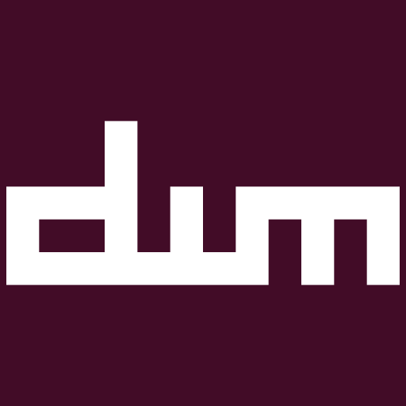

# dwm



<a href="./LICENSE"></a>
<a href="https://www.buymeacoffee.com/gabrielzschmitz" target="_blank"></a>
<a href="https://github.com/gabrielzschmitz/dwm"></a>

dwm (dynamic window manager) is a tiling window manager for the X Window System
developed by the suckless community. This package provides a custom build
maintained by [gabrielzschmitz](https://github.com/gabrielzschmitz), with
personal patches and configuration changes.

---

## Features

- Tiling window management
- System tray with configurable icon size
- Configurable bar and status padding
- Bottom stack, horizontal grid, gapless grid, and Fibonacci layouts
- Configurable master and client factors
- Window and stack movement between positions
- Configurable window gaps
- Colorful tags with underline indicators
- Status bar with `status2d` support
- Window icons and title suppression
- Preserve window-to-tag assignments across restarts
- Tag navigation, preview, and shifting
- Nix flake, package, and development shell included

---

## Build & Install

<details open>
<summary><b>With Make</b></summary>

```sh
cd src/
make
sudo make install
```

</details>

<details>
<summary><b>With Nix flakes</b></summary>

Build the package and enter the development shell:

```sh
nix build
nix develop
```

**Install on NixOS**

Add the flake input:

```nix
inputs.dwm.url = "github:gabrielzschmitz/dwm";
```

Add the package to your NixOS configuration:

```nix
environment.systemPackages = [
  inputs.dwm.packages.${pkgs.system}.default
];
```

Rebuild:

```sh
sudo nixos-rebuild switch --flake .#nixos
```

</details>

<details>
<summary><b>With Nix (`default.nix`)</b></summary>

Build the package:

```sh
nix-build -A dwm
```

**Install on NixOS**

```nix
environment.systemPackages = [
  (pkgs.callPackage /path/to/dwm/default.nix {})
];
```

Replace `/path/to/dwm` with the path to your local clone, then rebuild:

```sh
sudo nixos-rebuild switch
```

</details>

---

## Patches

This build includes the following patches:

- [systray](https://gitlab.com/-/snippets/2184056)
- [systray iconsize](https://dwm.suckless.org/patches/systray/)
- [barpadding](https://dwm.suckless.org/patches/barpadding/)
- [bottomstack](https://dwm.suckless.org/patches/bottomstack/)
- [cfacts](https://dwm.suckless.org/patches/cfacts/)
- [dragmfact](https://dwm.suckless.org/patches/dragmfact/)
- [dragcfact](https://github.com/bakkeby/dwm-flexipatch)
- [fibonacci](https://dwm.suckless.org/patches/fibonacci/)
- [gaplessgrid](https://dwm.suckless.org/patches/gaplessgrid/)
- [horizgrid](https://dwm.suckless.org/patches/horizgrid/)
- [movestack](https://dwm.suckless.org/patches/movestack/)
- [vanitygaps](https://dwm.suckless.org/patches/vanitygaps/)
- [colorful tags](https://github.com/fitrh/dwm/issues/1)
- [statuspadding](https://dwm.suckless.org/patches/statuspadding/)
- [status2d](https://dwm.suckless.org/patches/status2d/)
- [underline tags](https://dwm.suckless.org/patches/underlinetags/)
- [notitle](https://dwm.suckless.org/patches/notitle/)
- [winicon](https://dwm.suckless.org/patches/winicon/)
- [preserveonrestart](https://github.com/PhyTech-R0/dwm-phyOS/blob/master/patches/dwm-6.3-patches/dwm-preserveonrestart-6.3.diff)
- [shiftview](https://lists.suckless.org/dev/1104/7590.html)

Patch files are available in [`src/patches/`](./src/patches/). For additional
patches, see the [dwm patches archive](https://dwm.suckless.org/patches/).

---

## Configuration

The window manager can be customized through `src/config.def.h` and
`src/config.mk`. The status bar can be configured through `bar.sh`.

After changing the window manager configuration, rebuild dwm:

```sh
cd src/
make clean
make
```

Changes to `bar.sh` do not require rebuilding dwm. Restart the script for the
changes to take effect.

---

## License

This project is licensed under the MIT License. See the [LICENSE](./LICENSE)
file for details.
